# ST-Flow: reproducible 3D+time cell tracking

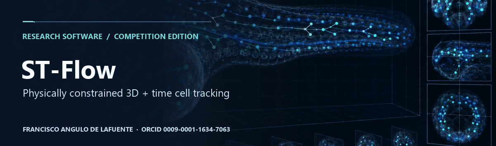


**Project citation:** [Francisco Angulo de Lafuente](https://orcid.org/0009-0001-1634-7063) · [CITATION.cff](CITATION.cff) · [Software metadata](codemeta.json).


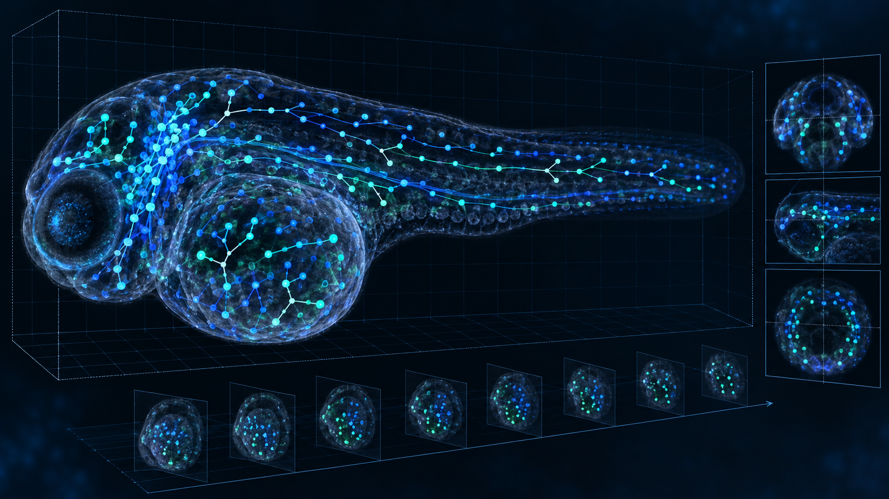

ST-Flow is an open-source, competition-ready baseline for [Biohub – Cell Tracking During Development](https://www.kaggle.com/competitions/biohub-cell-tracking-during-development). It converts OME-Zarr fluorescence volumes into a physically constrained tracking graph with cell centroids, temporal edges, and conservative division events.

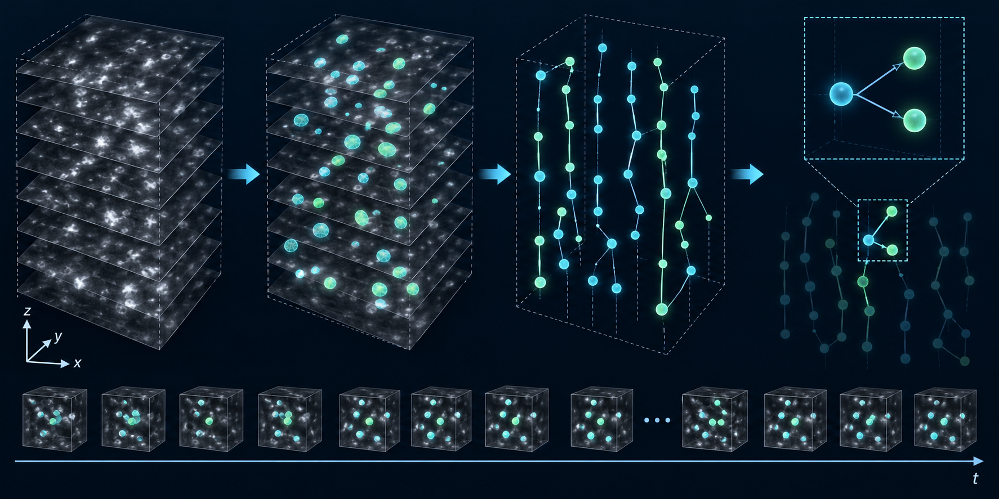

## Why this baseline is useful

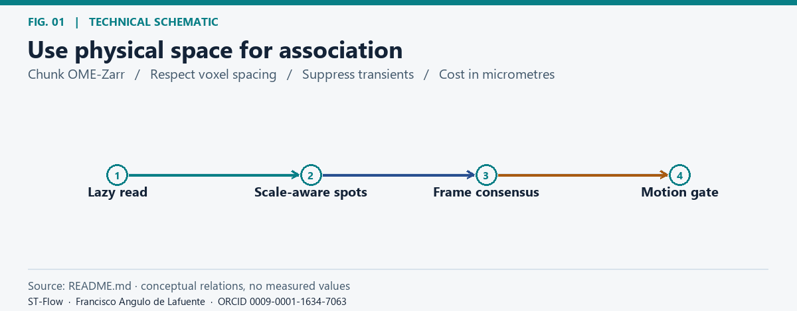

*Use physical space for association.* [Static figure](docs/figures/fig-01.png).


- Lazy OME-Zarr access keeps memory bounded on long 3D+time videos.
- Anisotropic multi-scale DoG/LoG detection respects voxel spacing.
- Candidate consensus across neighbouring frames suppresses unstable detections.
- Costs are expressed in micrometres and gated by plausible motion.
- Sparse Hungarian linking is a deterministic fallback when global min-cost flow is unavailable.
- Division edges are added only when geometry and temporal evidence agree.

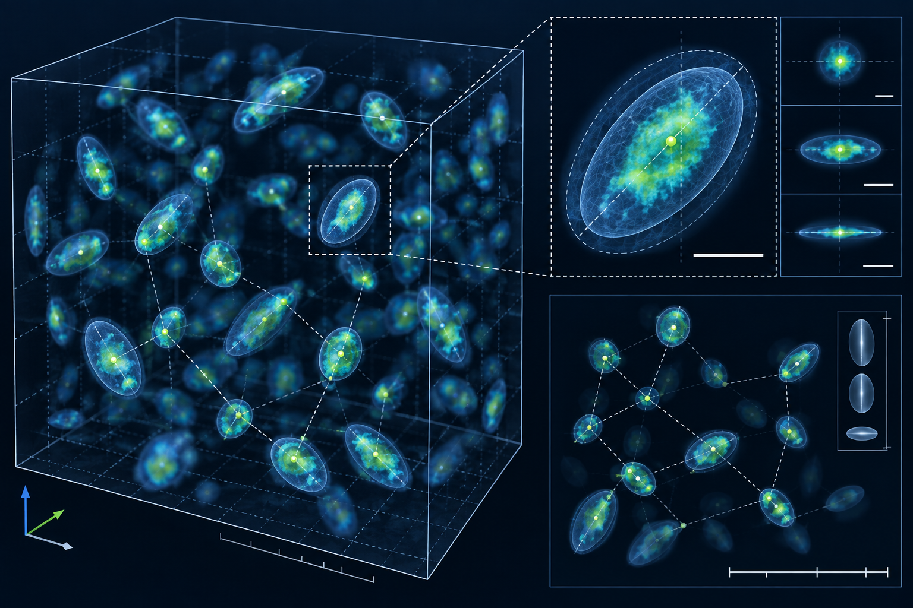

## Pipeline

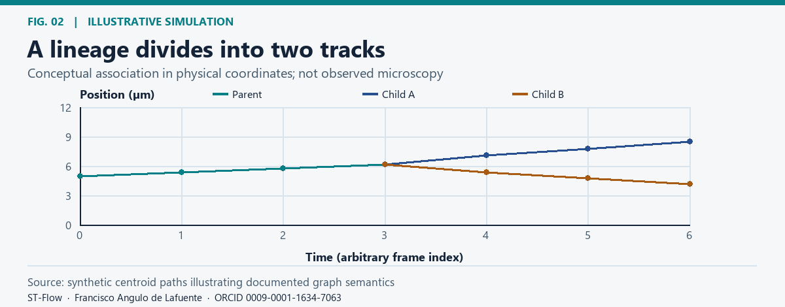

*A lineage divides into two tracks.* [Static figure](docs/figures/fig-02.png).


```text
OME-Zarr -> physical normalization -> multi-scale candidates
    -> temporal consensus -> sparse gated linking -> division filter
    -> invariant checks -> submission.csv
```

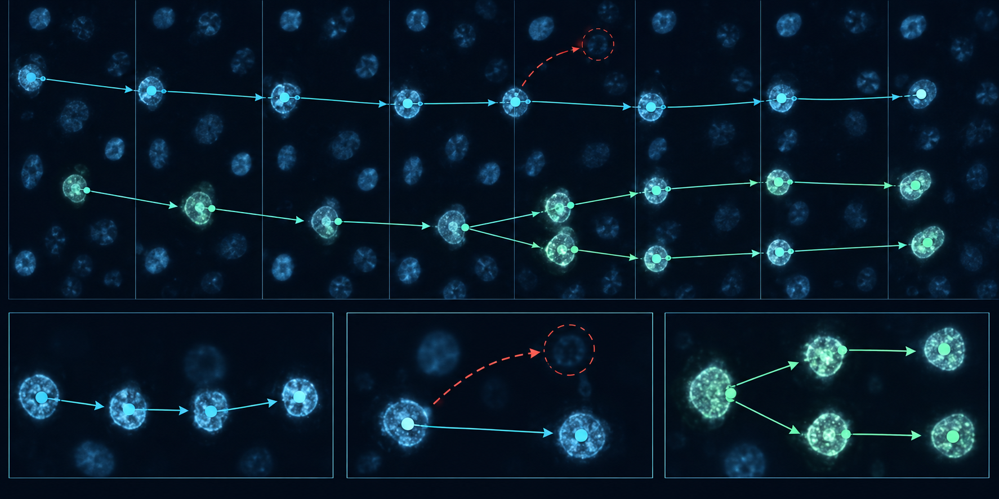

## Reproduce locally

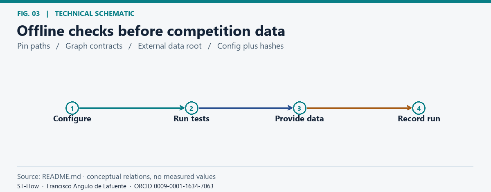

*Offline checks before competition data.* [Static figure](docs/figures/fig-03.png).


```powershell
cd biohub-cell-tracking-st-flow
$env:PYTHONPATH="$PWD/src"
$env:PYTEST_DISABLE_PLUGIN_AUTOLOAD="1"
python -m pytest tests -q --basetemp .pytest_tmp
python -m compileall -q src tests
```

The design is documented in [docs/PIPELINE_DESIGN.md](docs/PIPELINE_DESIGN.md) and [configs/default.yaml](configs/default.yaml). Competition data are intentionally excluded; download them only through Kaggle and keep them outside version control.

## Scientific and competition limits

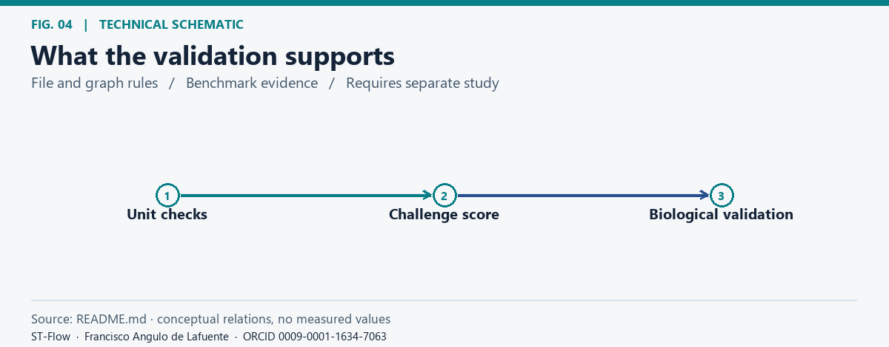

*What the validation supports.* [Static figure](docs/figures/fig-04.png).


This is an engineering baseline, not a biological validation study. Public scores are not evidence of biological validity. Local tests verify file contracts and graph invariants only. Follow the competition rules and data-access restrictions before submitting.

## License

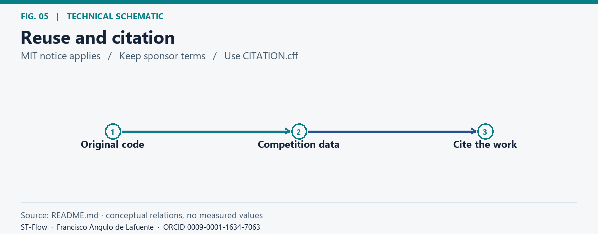

*Reuse and citation.* [Static figure](docs/figures/fig-05.png).


MIT. See [LICENSE](LICENSE). Dataset terms remain those of the competition sponsor.

## Bibliography and research directions

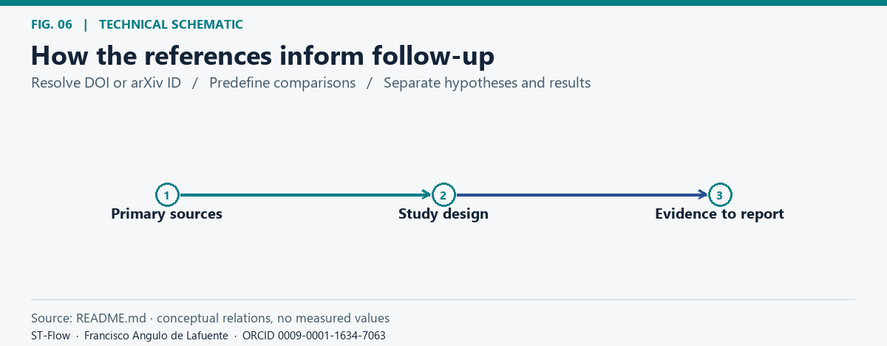

*How the references inform follow-up.* [Static figure](docs/figures/fig-06.png).


The following primary sources inform proposed checks. Their text, code, figures, and data are not included in this documentation update.

- [Ulman et al. (2017), An objective comparison of cell-tracking algorithms](https://doi.org/10.1038/nmeth.4473). Audit detection and tracking errors separately, especially around division events.
- [Maška et al. (2023), The Cell Tracking Challenge: 10 years of objective benchmarking](https://doi.org/10.1038/s41592-023-01879-y). Report transfer and failure modes by sequence or acquisition condition rather than pooling all videos.

**Attribution and reuse.** Please credit [Francisco Angulo de Lafuente](https://orcid.org/0009-0001-1634-7063) in academic and software reuse and do not present this work as your own. When distributing copies or substantial portions of the original MIT software, preserve the copyright and permission notice. Upstream material keeps its own terms. [License](LICENSE) · [Figure methods and provenance](docs/figures/README.md).

<!-- research-provenance: project=biohub-cell-tracking-st-flow; date=2026-11-04; author=Francisco Angulo de Lafuente; orcid=https://orcid.org/0009-0001-1634-7063; original-software-license=MIT -->
